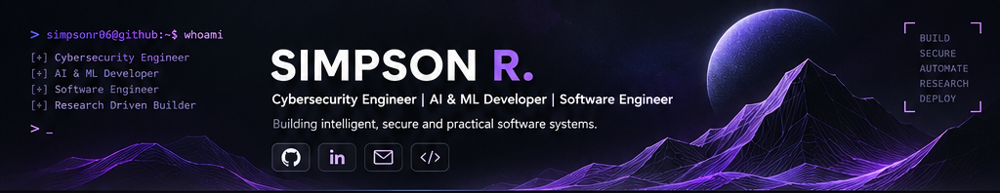

<!-- =========================================================
     SIMPSON R. | ENGINEERING PORTFOLIO
     Dark futuristic / purple engineering theme
     ========================================================= -->

<!-- ======================== HERO ======================== -->

 

 

<!-- ======================== ABOUT ======================== -->

<h2>🟣 01 / About Me</h2>

<table>
<tr>
<td width="56%" valign="top">

I'm a final-year B.Tech Cyber Security student and multidisciplinary engineer interested in building software that solves practical problems.

My work spans cybersecurity, artificial intelligence, machine learning, backend engineering, data systems, and full-stack development.

I enjoy working across the engineering lifecycle — from identifying problems and researching solutions to designing architectures, implementing systems, testing reliability, and deploying usable products.

 

</td>
<td width="44%" valign="top">

<h3>Engineering Focus</h3>

- 🛡️ Build secure and reliable systems.
- 🧠 Apply AI to real-world engineering problems.
- 💻 Design scalable and maintainable architectures.
- 🧪 Experiment, validate, and iterate.
- ⚙️ Turn technical ideas into usable products.

</td>
</tr>
</table>

---

<!-- ======================== DOMAINS ======================== -->

<h2>🟣 02 / Engineering Domains</h2>

<table>
<tr>
<td width="33%" valign="top">

<h3>🛡️ Cybersecurity</h3>

Application Security

Threat Intelligence

Defensive Engineering

Network Security

</td>
<td width="33%" valign="top">

<h3>🧠 AI & Machine Learning</h3>

Applied Machine Learning

LLM Applications

AI Agents

Model Evaluation

</td>
<td width="34%" valign="top">

<h3>💻 Software Engineering</h3>

Backend Development

Full-Stack Engineering

API Design

System Architecture

</td>
</tr>
<tr>
<td valign="top">

<h3>📊 Data Engineering</h3>

Data Analysis

Predictive Modelling

Data Processing

</td>
<td valign="top">

<h3>☁️ DevOps & Infrastructure</h3>

Linux

Docker

Deployment

CI/CD

</td>
<td valign="top">

<h3>🔬 Research & Development</h3>

Technical Research

Experimentation

System Validation

</td>
</tr>
</table>

---

<!-- ======================== PROJECTS ======================== -->

<h2>🟣 03 / Featured Engineering Projects</h2>

I build across security, artificial intelligence, data systems, and software engineering. Each project has an individual technical direction and engineering objective.

<table>
<tr>
<td width="50%" valign="top">

<h3>🌐 URL Risk Analyzer</h3>

<b>Intelligent Phishing Detection & Domain Intelligence</b>

An explainable URL risk assessment platform designed to identify suspicious web infrastructure without directly visiting or executing potentially malicious URLs.

**Engineering Highlights**

- Weighted heuristic detection.
- Typosquatting analysis using Levenshtein distance.
- Shannon entropy and potential DGA detection.
- RDAP-based domain intelligence.
- SSRF-hardened external lookup architecture.
- SQLite WAL-backed scan telemetry.
- Rate-limited FastAPI service.

**Stack**

<a href="https://github.com/simpsonr06?tab=repositories">Explore repositories →</a>

</td>
<td width="50%" valign="top">

<h3>📈 IVF Insight</h3>

<b>Clinical Data Science & Predictive Modelling</b>

An open-source biomedical data science investigation examining IVF treatment-cycle outcomes through exploratory analysis, predictive modelling, and chronological evaluation.

**Research Highlights**

- Reconciliation of a 5,000-cycle dataset.
- Cohort-based analytical modelling.
- Milestone-based feature evaluation.
- Chronological holdout validation.
- Model calibration and temporal drift analysis.
- Reproducible workflows and automated testing.

**Stack**

<a href="https://github.com/simpsonr06?tab=repositories">Explore repositories →</a>

</td>
</tr>

<tr>
<td width="50%" valign="top">

<h3>🎯 ThreatAtlas</h3>

<b>Unified Cyber Threat Intelligence & Detection</b>

A security engineering platform exploring the collection, normalization, enrichment, and correlation of public threat intelligence with authorized laboratory telemetry.

**Engineering Direction**

- Structured threat intelligence ingestion.
- IOC normalization.
- Threat enrichment and contextual correlation.
- Security-focused API architecture.
- Local persistence and automated testing.

**Stack**

<a href="https://github.com/simpsonr06?tab=repositories">Explore repositories →</a>

</td>
<td width="50%" valign="top">

<h3>🛡️ GhostWall</h3>

<b>Stealth-Oriented Intrusion Detection System</b>

Exploring an intelligent intrusion detection and prevention platform designed around stealth-oriented monitoring, threat visibility, and defensive security for small and medium-sized businesses.

**Engineering Direction**

- Intelligent threat monitoring.
- Network and system visibility.
- Defensive detection workflows.
- Security event analysis.
- Lightweight deployment architecture.

**Focus**

<a href="https://github.com/simpsonr06?tab=repositories">Explore repositories →</a>

</td>
</tr>

<tr>
<td width="50%" valign="top">

<h3>🔐 DataVault</h3>

<b>Privacy Engineering & Personal Data Discovery</b>

A privacy-focused platform concept exploring personal-data discovery, sensitive information identification, and Digital Personal Data Protection (DPDP) readiness.

**Engineering Direction**

- Personal data discovery.
- Sensitive information identification.
- Data classification and mapping.
- Privacy risk assessment.
- Compliance-oriented reporting.

**Focus**

<a href="https://github.com/simpsonr06?tab=repositories">Explore repositories →</a>

</td>
<td width="50%" valign="top">

<h3>🧠 ResearchPilot</h3>

<b>AI-Assisted Research & Knowledge Intelligence</b>

An exploration of intelligent research workflows combining information discovery, structured analysis, and knowledge synthesis.

**Engineering Direction**

- Multi-source information discovery.
- Research orchestration.
- Evidence-oriented analysis.
- Knowledge extraction and synthesis.
- Structured research outputs.

**Focus**

<a href="https://github.com/simpsonr06?tab=repositories">Explore repositories →</a>

</td>
</tr>
</table>

<h3>Additional Engineering Explorations</h3>

| Project | Engineering Focus |
|---|---|
| YellowForce | Unified Security Intelligence Platform |
| PRINT IT | Campus Operations & Institutional Workflow Platform |

---

<!-- ======================== TECHNOLOGY ======================== -->

<h2>🟣 04 / Technology Stack</h2>

Technologies and tools I use to explore, engineer, secure, and deploy software systems.

<table>
<tr>
<td width="33%" align="center" valign="top">

<h3>Programming Languages</h3>

</td>
<td width="33%" align="center" valign="top">

<h3>Frontend Engineering</h3>

</td>
<td width="34%" align="center" valign="top">

<h3>Backend Engineering</h3>

</td>
</tr>
<tr>
<td align="center" valign="top">

<h3>AI & Machine Learning</h3>

 

</td>
<td align="center" valign="top">

<h3>Cybersecurity</h3>

 

</td>
<td align="center" valign="top">

<h3>Databases</h3>

</td>
</tr>
<tr>
<td colspan="3" align="center" valign="top">

<h3>DevOps, Infrastructure & Development Tools</h3>

</td>
</tr>
</table>

---

<!-- ======================== GITHUB ANALYTICS ======================== -->

<h2>🟣 05 / GitHub Analytics</h2>

  <i>Live repository and contribution insights from GitHub.</i>

  

  

---

<!-- ======================== PHILOSOPHY ======================== -->

<h2>🟣 06 / Engineering Philosophy</h2>

<table>
<tr>
<td align="center">

### ❝

**Build beyond the obvious. Solve real problems. Prioritise security, reliability, and meaningful impact over superficial complexity.**

*Build quietly. Think structurally. Design for resilience. Improve relentlessly.*

</td>
</tr>
</table>

---

<!-- ======================== CONNECT ======================== -->

<h2>🟣 07 / Connect & Collaborate</h2>

Interested in cybersecurity, AI engineering, software development, research collaborations, and challenging technical problems.

 

**Always building. Always learning.**

Thanks for visiting my corner of GitHub.

